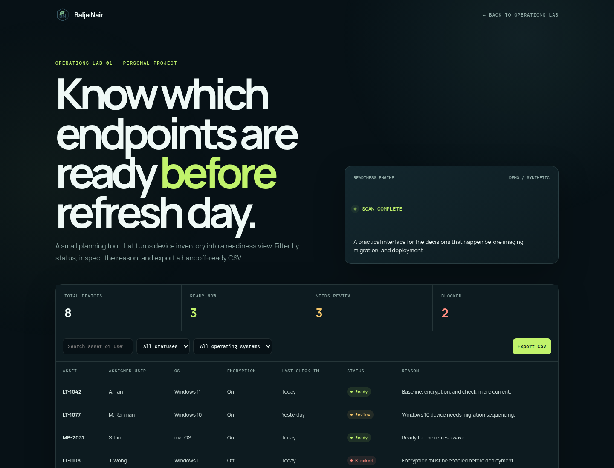

# Endpoint Refresh Readiness Checker

## Problem
Endpoint refreshes are easier to deliver when the team can see which devices are ready, which need sequencing, and which are blocked before deployment day.

## Approach
This dependency-free browser tool uses a small synthetic device inventory. It applies transparent readiness rules around operating-system migration, encryption, and recent check-in status. Recruiters can search, filter, inspect the reason behind a status, and export the visible view as CSV.

## Tools
HTML, CSS, JavaScript, browser `Blob`/download APIs, and synthetic JSON-like records embedded in the page.

## Outcome
The demo shows how I would turn endpoint inventory into a concise operational handoff rather than another undifferentiated spreadsheet.

## Data and scope
This is a personal project. All device IDs, names, operating systems, and status records are fictional synthetic data. No employer, client, or personal data is included.

## Run locally
From the repository root, run `python -m http.server 4177` and open `http://localhost:4177/projects/endpoint-readiness/`.
