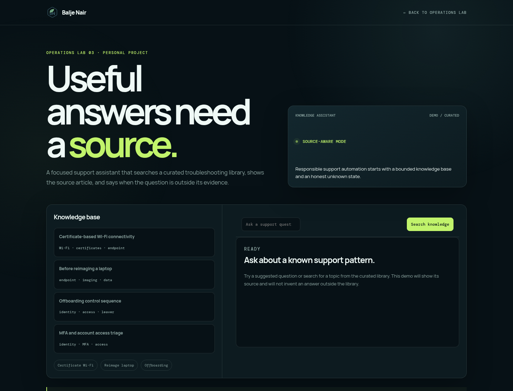

# IT Support Knowledge Assistant

## Problem
Support automation becomes risky when an assistant answers beyond its evidence. A useful support helper should retrieve from a bounded library, show the source, and make uncertainty visible.

## Approach
This dependency-free demo searches a curated set of troubleshooting patterns for certificate-based Wi-Fi, endpoint reimaging, offboarding, and MFA access triage. It displays a source label for grounded answers and an explicit unknown state for unsupported questions.

## Tools
HTML, CSS, JavaScript, DOM search, curated Markdown-like article records, and no external AI API. The bounded approach is intentional for a trustworthy portfolio demonstration.

## Outcome
The project shows how I would apply agentic-AI thinking to IT support without pretending that a generated answer is an approved production runbook.

## Data and scope
This is a personal project. The knowledge articles are original synthetic demonstration content based on general support patterns. It does not contain employer or client documentation and does not modify any live system.

## Run locally
From the repository root, run `python -m http.server 4177` and open `http://localhost:4177/projects/it-support-assistant/`.
