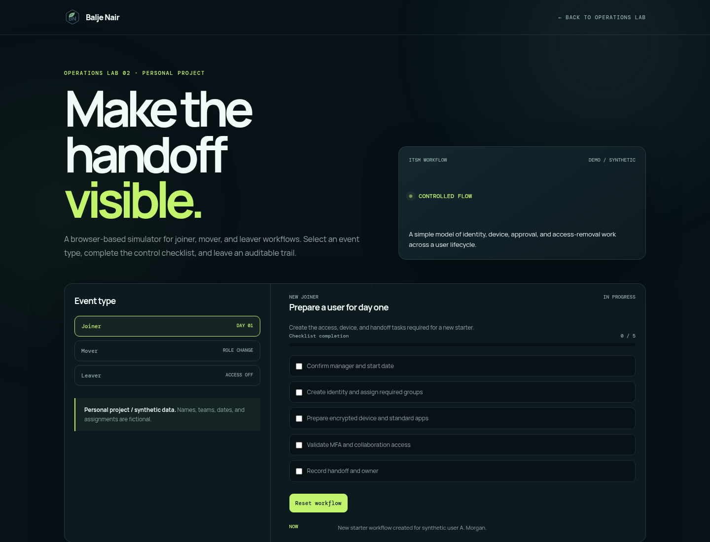

# Joiner–Mover–Leaver Workflow Simulator

## Problem
Identity and device lifecycle work is easy to describe poorly. A good handoff makes the required controls, owner, and evidence visible for joiners, role changes, and leavers.

## Approach
This browser simulator models three synthetic flows. Each flow has a task checklist, progress state, and a small audit trail. It is deliberately not connected to a real directory or ITSM platform; the value is in making the operational sequence clear.

## Tools
HTML, CSS, JavaScript, DOM state, accessible buttons, checkboxes, and local synthetic workflow definitions.

## Outcome
This demo communicates ITSM and identity-management thinking through a concrete interaction: access is not simply “done”; each lifecycle event has an owner-visible sequence and closure state.

## Case study
Read the longer project narrative on the [rendered case-study page](case-study.html). The source Markdown is retained in [CASE-STUDY.md](CASE-STUDY.md) for GitHub documentation.

## Data and scope
This is a personal project. All names, dates, assignments, and workflow records are fictional synthetic data. It does not modify real identities, devices, or applications.

## Run locally
From the repository root, run `python -m http.server 4177` and open `http://localhost:4177/projects/jml-workflow/`.
